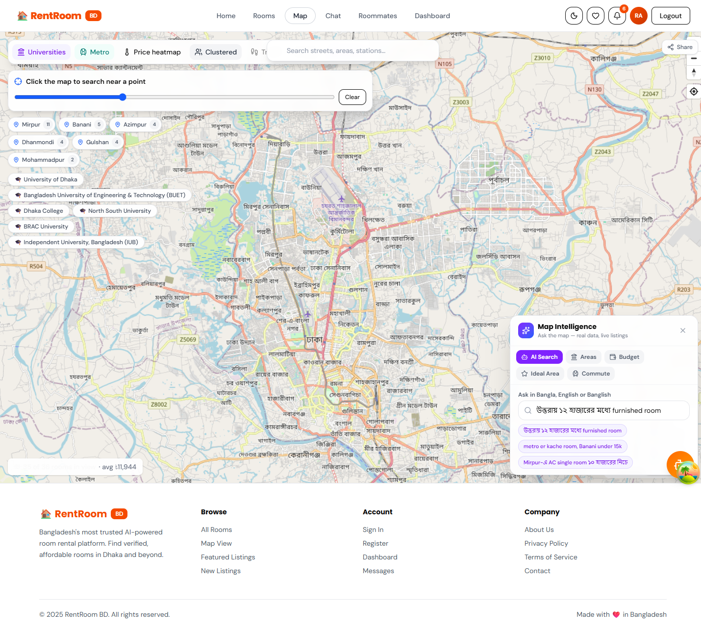
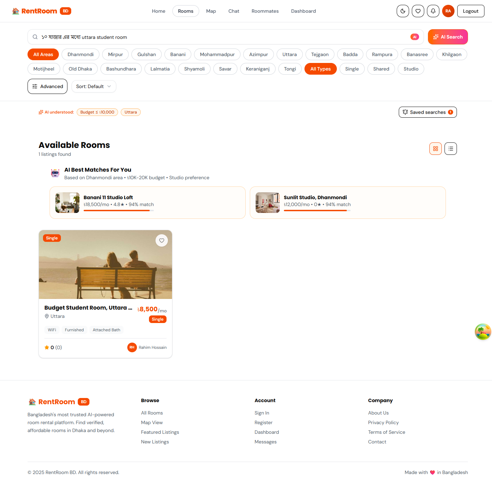
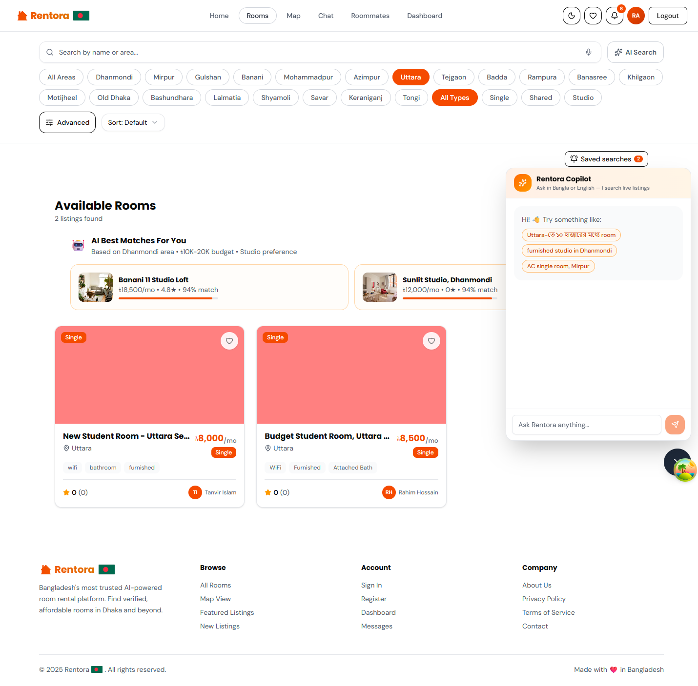
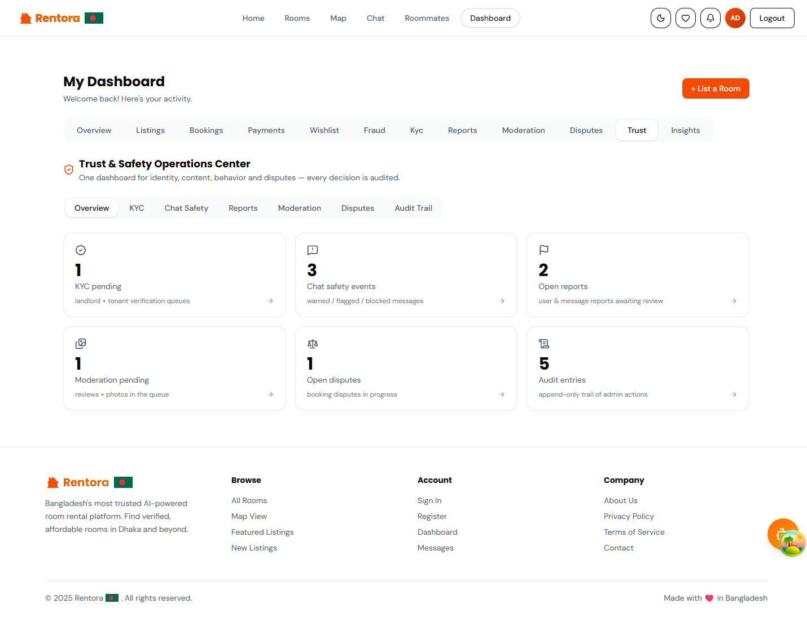
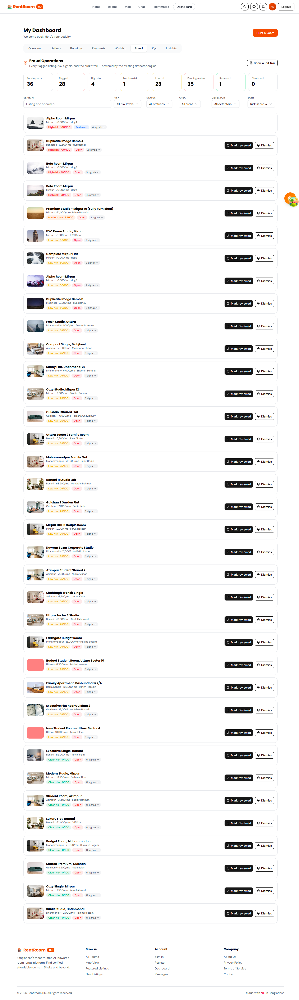
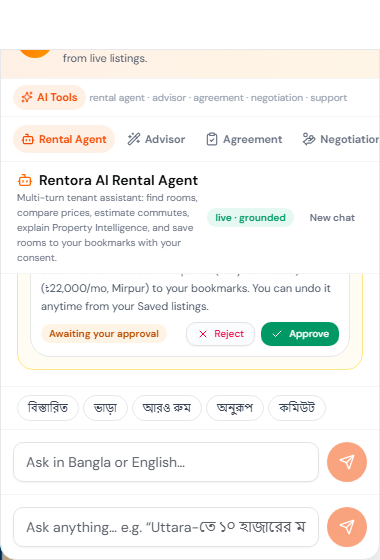
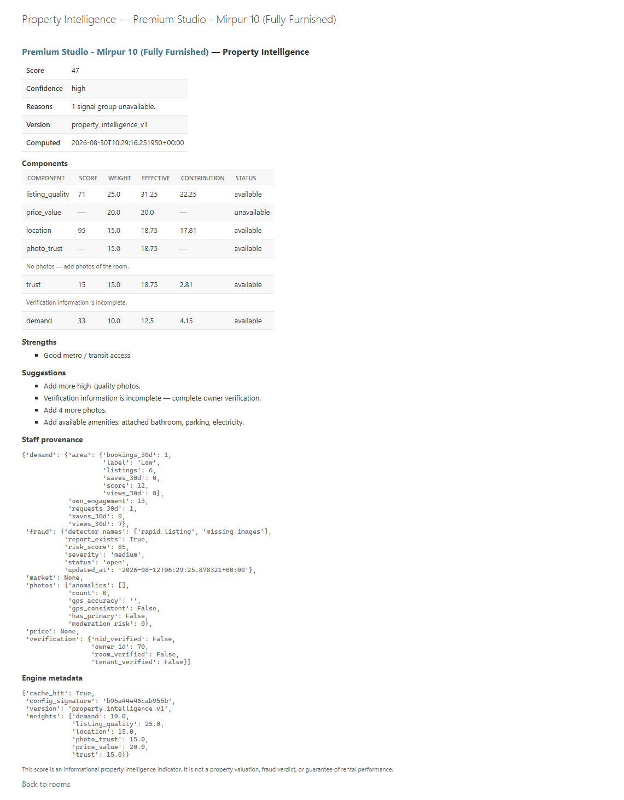
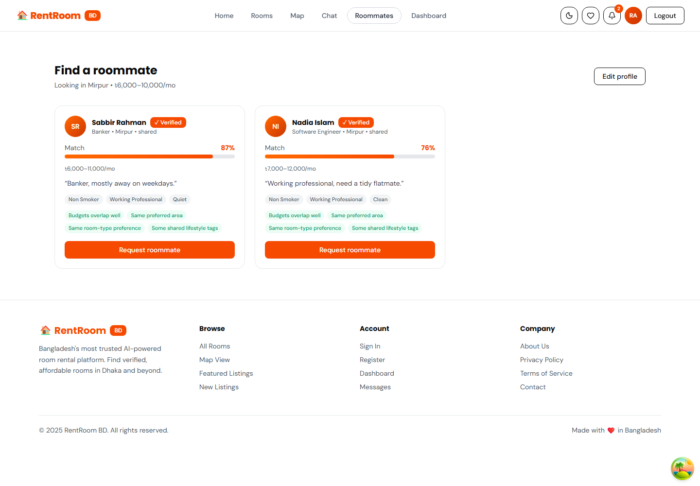
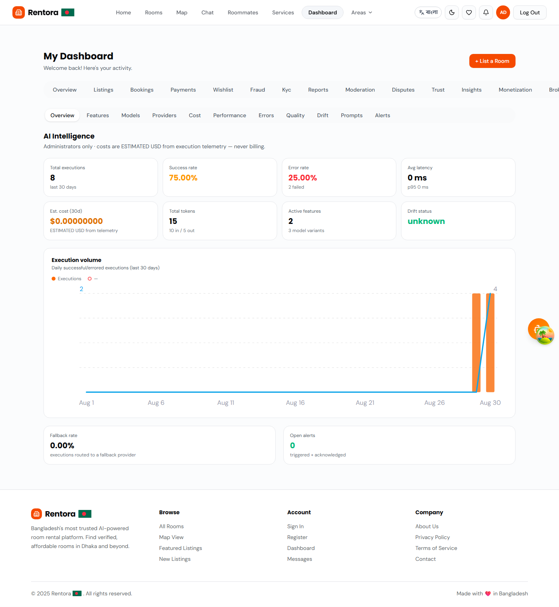

# Rentora

**An intelligent, trust-first room rental platform for Bangladesh.**

Rentora helps tenants in Dhaka find verified, fairly priced rooms and helps landlords fill them faster. It combines natural-language search in Bangla, Banglish and English, an intelligent map, real-time chat, local payment gateways, roommate matching, and a fraud and trust layer that protects both sides of the marketplace.

[](https://github.com/SadManFahIm/Rentora/actions/workflows/ci.yml)
[](https://github.com/SadManFahIm/Rentora/actions/workflows/security.yml)
[](https://www.python.org/)
[](https://www.djangoproject.com/)
[](https://www.django-rest-framework.org/)
[](https://react.dev/)
[](https://www.typescriptlang.org/)
[](https://tailwindcss.com/)
[](https://www.postgresql.org/)
[](LICENSE)



---

## Table of Contents

- [Overview](#overview)
- [Key Features](#key-features)
- [Screenshots](#screenshots)
- [Tech Stack](#tech-stack)
- [Architecture](#architecture)
- [Project Structure](#project-structure)
- [Getting Started](#getting-started)
- [Configuration](#configuration)
- [Demo Accounts](#demo-accounts)
- [Testing and Quality](#testing-and-quality)
- [API](#api)
- [Security](#security)
- [Roadmap](#roadmap)
- [Documentation](#documentation)
- [Contributing](#contributing)
- [Author](#author)
- [License](#license)

---

## Overview

| | |
|---|---|
| **Problem** | Finding a trustworthy room in Dhaka is hard. Listings are scattered, landlords are difficult to verify, prices are opaque, and rental scams are common. |
| **Solution** | One verified marketplace with automated listing checks, identity verification for both landlords and tenants, transparent market pricing, real-time chat, local payment gateways and roommate matching. |
| **Audience** | Tenants (students and young professionals) and landlords across Dhaka. |
| **Differentiators** | A layered trust and fraud system, Bangla-first natural-language discovery, grounded assistants that only answer from real platform data, and a complete monetization layer (listing tiers, subscriptions, brokers, corporate housing, add-on services). |

**Design principles**

- **Grounded, never invented.** Every recommendation, price insight and assistant answer is computed from real listings and market data. When data is too thin, the platform says so instead of guessing.
- **Human in the loop.** Automated agents propose; people approve. No state-changing action (bookings, price changes, offers) happens without explicit consent.
- **Safe by default.** New AI capabilities ship behind feature flags that are off by default, with telemetry, evaluation and alerting in place before they are enabled.

---

## Key Features

### Discovery and search

- **Natural-language search** in Bangla, Banglish and English (for example, *"উত্তরায় ১২ হাজারের মধ্যে furnished room"*), with intent chips that show what was understood.
- **Hybrid semantic ranking** combining embeddings with TF-IDF/LSA, fraud-aware and quality-aware re-ranking, and a semantic query cache.
- **Bangla voice search** and **image search** ("upload a photo, find rooms that look like it").
- **Intelligent map** built on MapLibre GL: price pins and clustering, radius and viewport search, metro commute scores, value scores, area intelligence and comparison, affordability heatmaps, isochrones, and map-list sync with shareable deep links.
- **Saved searches** with smart matching, price-drop alerts and email digests.
- **Recommendations** using content-based, collaborative and hybrid models, plus visually similar rooms.
- **Roommate matching** by budget, area, lifestyle and gender preference.

### Trust, safety and fraud prevention

- **Fraud engine** that scans every listing automatically: duplicate listings and descriptions, suspicious pricing, rapid posting, missing images, unverified owners, duplicate-image detection across listings, photo forensics (manipulation and watermark detection) and photo-location mismatch checks.
- **Scam-network graph** with community detection to surface fraud rings, plus fake-review detection and review trust scoring.
- **Identity verification (KYC)** for landlords and tenants, with document OCR, liveness and face-match through pluggable providers, verified badges and an SLA-tracked admin review queue.
- **Chat safety engine** that screens messages for payment-redirect scams, phishing links and impersonation.
- **Report and block**, **photo and review moderation**, and **disputes with deposit protection**.
- **Trust and Safety Operations Center** for admins, backed by an append-only audit trail.

### Rentora assistants and agents

- **Rentora Copilot**, a conversational assistant for discovery and listing questions. Answers come only from retrieved listings, so it cannot invent a room, price or amenity.
- **Rental Agent** for tenants: searches the live catalogue, explains listings, estimates commutes and compares prices. Any bookmark or other change waits for the tenant's approval.
- **Listing Autopilot** for landlords: a weekly analysis that proposes title, description, amenity, photo and price improvements for review and one-click approval.
- **Negotiation Agent**: two-sided rent negotiation with private boundaries for each party, consent required for every binding step, and a hand-off to booking.
- **Property Intelligence** scores combining pricing, quality, trust, location and demand signals.
- **AI tools**: rental advisor, negotiation assistant, agreement checker, landlord copilot, property comparison, demand forecasting, smart alerts, listing drafts from photos and review summaries.

### Pricing and market insight

- **Market statistics** per area and room type, with plain-language price insight ("great deal", "fair price", "overpriced").
- **Fair-price prediction** with an explainable regression model, price-anomaly badges, per-listing price recommendations and demand-aware pricing suggestions.
- Pricing labels and the fraud engine share a single rule for suspiciously low prices, so a listing flagged as possible bait is never promoted as a bargain.

### Bookings, payments and monetization

- **Bookings** with landlord approval, reviews with verified-stay badges, and wishlists.
- **Payments** through **SSLCommerz** and **bKash**: refunds, PDF receipts, invoices, security deposits and webhook audit.
- **Monetization**: paid listing tiers (Free, Featured, Premium), landlord subscriptions and entitlements, an idempotent revenue ledger with commissions, a verified broker network with payouts, corporate housing accounts, an add-on services marketplace, and insurance and credit partnerships.

### Communication and reach

- **Real-time chat** over WebSockets with typing indicators, read receipts, file sharing, message search and edit/delete, and English-Bangla translation.
- **Real-time and browser push notifications**, transactional emails and SMS OTP sign-in.
- **WhatsApp listing sharing**, per-area SEO landing pages and a sitemap.
- **Full English and Bangla interface** with a one-click language toggle and dark mode.

### Accounts and security

- JWT authentication, **passkeys (WebAuthn)**, email two-factor authentication with recovery codes, and SMS OTP sign-in.
- Password strength scoring and breach checks (k-anonymity) at registration.

### Progressive Web App

- Installable on desktop and mobile, with standalone mode, app shortcuts, update prompts, offline search over cached public listings and background sync. Sensitive data such as auth, payments and admin is never cached.

### Platform AI operations

- **Feature and prompt registries** with versioned prompts and rollback.
- **Execution telemetry** (latency, tokens, cost, confidence) and **provider health monitoring** with automatic degradation.
- **Evaluation framework** with golden datasets, built-in evaluators and regression detection.
- **AI Intelligence Dashboard** with configurable alert rules, deduplication and cooldowns.
- **Feature flags and A/B experiments** for every AI capability.

---

## Screenshots

| | |
|---|---|
|  |  |
| **Natural-language search** with intent chips and semantic ranking | **Rentora Copilot**, grounded answers over live listings |
|  |  |
| **Trust and Safety Operations Center** | **Fraud review queue** with risk scores |
|  |  |
| **Rental Agent** with approval-gated actions | **Property Intelligence** score |
|  |  |
| **Roommate matching** | **AI Intelligence Dashboard** for admins |

The full gallery (light and dark, desktop and mobile) lives in [`docs/screenshots/`](docs/screenshots/README.md). Screenshots can be regenerated with [`docs/tools/capture-screenshots.mjs`](docs/tools/capture-screenshots.mjs).

---

## Tech Stack

### Frontend

| Area | Technology |
|---|---|
| Framework | React 19, TypeScript (strict), Vite 8 |
| Styling and UI | Tailwind CSS v4, shadcn/ui, Motion |
| Routing and state | React Router 8, TanStack Query, Zustand |
| Forms and validation | React Hook Form, Zod |
| Maps | MapLibre GL JS |
| Internationalization | i18next (English and Bangla) |
| Auth and security | @simplewebauthn/browser (passkeys), zxcvbn-ts, HIBP k-anonymity check |
| Observability | Sentry |
| Testing | Vitest, Testing Library, Playwright |
| Tooling | ESLint, Prettier, husky, lint-staged |

### Backend

| Area | Technology |
|---|---|
| Framework | Python 3.12, Django 6.1, Django REST Framework 3.18 |
| Real-time | Django Channels, Daphne (ASGI) |
| Auth | SimpleJWT, django-allauth, py_webauthn |
| Data | PostgreSQL 16 (production), SQLite (development), pgvector (optional) |
| Cache, queues and jobs | Redis, Celery and Celery Beat |
| Search and ML | scikit-learn (TF-IDF/LSA, regression), NumPy, optional neural sentence embeddings, perceptual image hashing (Pillow) |
| API documentation | drf-spectacular (OpenAPI, Swagger UI, ReDoc) |
| Payments | SSLCommerz, bKash Tokenized Checkout |
| Notifications | Web Push (VAPID), transactional email, pluggable SMS gateway |
| Observability | Sentry, structured JSON logs, request correlation IDs, `/health/` endpoint |
| Quality | Django test runner, coverage, ruff, Bandit, pip-audit |

---

## Architecture

```
┌──────────────────────────────────────────────────────────────────┐
│                     Frontend — React SPA / PWA                   │
│   Pages · TanStack Query hooks · services (Axios) · Zustand      │
│   MapLibre GL · WebSocket client · service worker · i18n EN/BN   │
└───────────────┬───────────────────────────────┬──────────────────┘
                │ HTTPS  /api/v1/*              │ WSS  /ws/*
┌───────────────▼───────────────────────────────▼──────────────────┐
│                   Django (ASGI — Daphne + Channels)              │
│                                                                  │
│  Accounts & auth    JWT · 2FA · passkeys · SMS OTP · KYC          │
│  Marketplace        rooms · bookings · payments · monetization   │
│  Discovery          NL parser · hybrid ranking · map intelligence│
│  Trust & safety     fraud engine · scam graph · moderation ·     │
│                     chat safety · disputes · audit log           │
│  Assistants         Copilot · Agent SDK · rental / negotiation   │
│                     agents · listing autopilot                   │
│  AI operations      registries · telemetry · evaluation · alerts │
│  Platform           feature flags · experiments · image pipeline │
│                                                                  │
│  Celery + Beat: scans, digests, alerts, autopilot, market stats  │
└───────┬──────────────────────┬──────────────────────┬────────────┘
        │                      │                      │
┌───────▼─────────┐   ┌────────▼────────┐   ┌─────────▼──────────┐
│ PostgreSQL 16 / │   │ Redis           │   │ External services  │
│ SQLite (dev)    │   │ cache · channel │   │ SSLCommerz · bKash │
│ (+ pgvector)    │   │ layer · broker  │   │ email · SMS · push │
└─────────────────┘   └─────────────────┘   └────────────────────┘
```

Every external integration (payment gateways, SMS, KYC verification, embeddings, language providers) sits behind a provider abstraction with a safe local default, so the full platform runs locally with no third-party accounts.

See [`docs/architecture.md`](docs/architecture.md) for the data model, request flows and deployment design.

---

## Project Structure

```
Rentora/
├── backend/                     Django project
│   ├── config/                  Settings (base/dev/prod), URLs, ASGI, Celery, middleware
│   ├── users/                   Custom user model, auth, 2FA, passkeys, SMS OTP, KYC
│   ├── rooms/                   Listings, images, geo queries, map intelligence, ranking
│   ├── bookings/                Bookings and reviews
│   ├── payments/                SSLCommerz and bKash, refunds, invoices, deposits
│   ├── pricing/                 Market statistics, price insight, fair-price prediction
│   ├── fraud/                   Fraud detectors, scam-network graph, photo forensics
│   ├── moderation/              Photo and review moderation
│   ├── disputes/                Disputes and deposit protection
│   ├── chat/                    Real-time chat, presence, chat safety, translation
│   ├── notifications/           In-app, push and email notifications
│   ├── recommendations/         Content-based, collaborative and hybrid recommenders
│   ├── embeddings/              Embedding service (pgvector-ready)
│   ├── savedsearches/           Saved searches, matching and digests
│   ├── roommates/               Roommate profiles and matching
│   ├── wishlist/                Wishlists
│   ├── copilot/                 Rentora Copilot and AI tools
│   ├── agents/                  Agent SDK: sessions, tools, consent proposals
│   ├── rental_agent/            Tenant-facing rental agent
│   ├── negotiation_agent/       Two-sided negotiation agent
│   ├── listing_autopilot/       Weekly landlord listing analysis
│   ├── property_intelligence/   Property Intelligence score
│   ├── ai_intelligence/         Feature/prompt registries, telemetry, evaluation, alerts
│   ├── ml_models/               Model tracking and drift monitoring
│   ├── feature_flags/           Feature flags
│   ├── experiments/             A/B experiments
│   ├── images/                  Image pipeline (WebP variants, private storage)
│   ├── analytics/               First-party analytics, funnels, market reports, forecasts
│   ├── audit/                   Append-only audit trail
│   ├── dashboard/               Aggregated dashboard statistics
│   ├── monetization/            Listing tiers, revenue ledger, commissions, payouts
│   ├── subscriptions/           Landlord subscriptions and entitlements
│   ├── brokers/                 Verified broker network
│   ├── corporate/               Corporate housing accounts and invoicing
│   ├── marketplace/             Add-on services marketplace
│   ├── partner_services/        Insurance and credit partnerships
│   └── providers/               Shared provider abstraction and registry
├── frontend/                    React + TypeScript SPA
│   └── src/
│       ├── pages/               Route-level pages
│       ├── components/          Feature and UI components (shadcn/ui primitives in ui/)
│       ├── hooks/               TanStack Query hooks
│       ├── services/            API service layer and wire-type mappers
│       ├── stores/              Zustand stores
│       ├── context/             App context (auth)
│       ├── i18n/                English and Bangla translations
│       ├── lib/                 Utilities (PWA, offline DB, schema contract, maps)
│       └── types/               Shared TypeScript types
├── docs/                        Architecture, API reference, ADRs, guides, phase specs
├── scripts/                     Backup and utility scripts
├── .github/                     CI, security and dependency-update workflows
├── docker-compose.dev.yml       Local PostgreSQL and Redis
└── Makefile                     Common development commands
```

---

## Getting Started

### Prerequisites

- Python 3.12
- Node.js 22
- Git
- Optional: PostgreSQL 16 and Redis 7 (Docker Compose file included)

### Quick start

```bash
git clone https://github.com/SadManFahIm/Rentora.git
cd Rentora
```

**Backend** (http://localhost:8000):

```bash
cd backend
python -m venv venv
source venv/bin/activate        # Windows: venv\Scripts\activate
pip install -r requirements.txt
python manage.py migrate
python manage.py seed_rooms     # demo listings and demo users
python manage.py runserver
```

**Frontend** (http://localhost:3000), in a second terminal:

```bash
cd frontend
npm install
cp .env.example .env
npm run dev
```

No `.env` file is required for the backend. Sensible defaults run everything locally: SQLite, in-memory channels, synchronous Celery tasks, sandbox payment credentials and console SMS/email.

### Using the Makefile

```bash
make setup      # install backend and frontend dependencies
make dev        # run backend and frontend together
make migrate    # apply migrations
make seed       # seed demo data
make test       # backend and frontend unit tests
make check      # full pre-PR gate: lint, format check, tests, build
```

Run `make help` to list every command.

### Optional services

**PostgreSQL and Redis** via Docker:

```bash
docker compose -f docker-compose.dev.yml up -d
```

Then set `DB_ENGINE=postgres` (and the `DB_*` values) and `CHANNELS_BACKEND=redis` in `backend/.env`.

**Celery workers.** With no broker configured, tasks run synchronously. To run real workers and the beat schedule, set `CELERY_BROKER_URL=redis://localhost:6379/0` and start:

```bash
celery -A config worker -l info
celery -A config beat -l info
```

**Useful management commands**

```bash
python manage.py createsuperuser        # admin account (/admin/)
python manage.py scan_rooms             # run the fraud engine over all listings
python manage.py update_market_stats    # recompute market pricing statistics
python ../scripts/backup_db.py --keep 14
```

---

## Configuration

Configuration is read from environment variables. Copy `backend/.env.example` to `backend/.env` and `frontend/.env.example` to `frontend/.env`; both files document every option.

| Variable | Purpose | Default |
|---|---|---|
| `DJANGO_SETTINGS_MODULE` | Settings module | `config.settings.dev` |
| `SECRET_KEY`, `DEBUG`, `ALLOWED_HOSTS` | Core Django settings | Development values |
| `DB_ENGINE`, `DB_NAME`, `DB_USER`, `DB_PASSWORD`, `DB_HOST`, `DB_PORT` | Database | SQLite |
| `CHANNELS_BACKEND`, `REDIS_URL` | WebSocket channel layer and cache | In-memory |
| `CELERY_BROKER_URL` | Async task broker | Empty (synchronous tasks) |
| `SSLCOMMERZ_*`, `BKASH_*` | Payment gateways | Sandbox credentials only |
| `FRONTEND_URL`, `CORS_ALLOWED_ORIGINS` | Frontend origin | `http://localhost:3000` |
| `SENTRY_DSN`, `JSON_LOGS` | Error tracking and structured logs | Disabled |
| `SMS_OTP_ENABLED`, `SMS_PROVIDER` | Phone sign-in | Disabled / console |
| `VITE_API_BASE_URL` | Frontend API base URL | `http://localhost:8000/api/v1` |
| `VITE_SENTRY_DSN` | Frontend error tracking | Disabled |

AI capabilities are controlled by feature flags and are **off by default**. They can be enabled from the admin once a provider is configured. Never commit real credentials; production secrets belong in the deployment environment.

---

## Demo Accounts

After running `python manage.py seed_rooms`, sign in with any of these accounts (username or email). The password for all of them is **`demo12345`**.

| Username | What to explore |
|---|---|
| `rahim.hossain` | Roommate matches, listings, promoting a listing to a paid tier |
| `nadia.islam` | Premium shared listing in Gulshan |
| `sabbir.rahman` | Student room in Azimpur |
| `farhana.akter` | Modern studio in Mirpur |
| `tanvir.islam` | Fraud dashboard with risk cards and re-scan |
| `demo.promoter` | Fresh free listing for the end-to-end promotion flow |
| `kyc.demo` | Unverified landlord: upload a KYC document and watch the verified badge appear after approval |
| `kyc.rejected` | Rejected KYC: see the reviewer's note and re-upload |

All seeded accounts are landlords. To explore the tenant experience, register a new account. For the admin console, create a superuser and open http://localhost:8000/admin/.

---

## Testing and Quality

| Suite | Tests | Command |
|---|---|---|
| Backend unit and integration | 1,672 (85% coverage) | `cd backend && python manage.py test --exclude-tag=e2e` |
| Backend end-to-end (fraud, payments, KYC) | 32 | `cd backend && python manage.py test --tag=e2e` |
| Frontend unit and component | 458 | `cd frontend && npm test` |
| Browser end-to-end | 14 | `cd frontend && npm run test:e2e` |

**Code quality**

- **Python:** ruff (lint and format).
- **TypeScript:** strict mode, ESLint and Prettier.
- **Pre-commit hooks:** husky and lint-staged run ruff, ESLint and Prettier on staged files.
- **Full gate:** `make check` runs lint, format check, type check, tests and the production build.

**Continuous integration.** Every pull request must pass all gates before merging:

| Gate | What it checks |
|---|---|
| Backend | Django test suite with a coverage threshold |
| Frontend | Vitest, coverage, lint, format and production build |
| End-to-end | Fraud, payment and KYC flows; Playwright browser tests |
| API contract | Live endpoints validated against the OpenAPI schema and documentation |
| Frontend contract | TypeScript types regenerated from the OpenAPI schema and checked against the client |
| Schema drift | API changes summarized as a pull-request comment |
| Performance | Lighthouse performance budget |
| Security | pip-audit, Bandit, Django deployment checks, security regression tests, npm audit and gitleaks secret scanning |

Dependency updates are proposed automatically each week and merged only after every check passes.

---

## API

The REST API is versioned under `/api/v1/` and documented with OpenAPI:

| Endpoint | Description |
|---|---|
| `/api/v1/docs/` | Swagger UI |
| `/api/v1/redoc/` | ReDoc |
| `/api/v1/schema/` | OpenAPI schema |

Main resource groups: authentication and accounts, rooms and search, map intelligence, bookings and reviews, payments, pricing, recommendations, saved searches, wishlist, chat, notifications, roommates, KYC, fraud, moderation, disputes, Copilot and agents, monetization, analytics, and admin AI operations.

The complete endpoint reference with request and response examples is in [`docs/api-reference.md`](docs/api-reference.md).

---

## Security

- JWT authentication with token rotation, email two-factor authentication with hashed single-use recovery codes, and phishing-resistant passkeys.
- Rate limiting on authentication, payments, chat and reporting endpoints, plus duplicate and abuse guards.
- Input sanitization, Content Security Policy and production security headers.
- Identity documents are served only through authorization-checked endpoints and are never exposed through public media URLs.
- PII masking in logs and admin views, and an append-only audit log for sensitive actions.
- Upload validation with malware scanning support.
- Automated security scanning in CI (see [Testing and Quality](#testing-and-quality)).

To report a vulnerability, follow [SECURITY.md](SECURITY.md). Further details are in the [security audit](docs/security/SECURITY_AUDIT.md) and the [production checklist](docs/security/SECURITY_CHECKLIST.md).

---

## Roadmap

| Phase | Scope | Status |
|---|---|---|
| 1–3 | React prototype, TypeScript/Vite/Tailwind refactor, Django backend with JWT and REST API | Shipped |
| 4–6 | Real-time chat and notifications; SSLCommerz and bKash payments; recommendations and pricing | Shipped |
| 7 | Intelligent map: clustering, commute scores, area intelligence, affordability, deep links | Shipped |
| 9–10 | Reliability and observability; growth and personalization (push, saved searches, referrals) | Shipped |
| 11 | Natural-language and voice search, listing quality, Rentora Copilot, pricing v2, duplicate-image fraud | Shipped |
| 12 | Progressive Web App; Trust and Safety v2 (tenant KYC, chat safety, moderation, disputes); tiered upgrades | Shipped |
| 13–14 | Reach (SMS OTP, WhatsApp sharing, SEO pages); photo intelligence and image search | Shipped |
| 15 | Monetization 2.0 (subscriptions, ledger, brokers, corporate, marketplace); communication and trust AI | Shipped |
| 16 | Hardening and scale: feature flags, experiments, image pipeline, Redis, rate limiting, Celery reliability | Shipped |
| 17 | Scam-network graph, KYC liveness, photo-location checks, fake-review detection, drift monitoring, PII masking | Shipped |
| 18 | AI operations: registries, telemetry, evaluation framework, dashboard and alerts | Shipped |
| 19 | Agent SDK, Property Intelligence, Rental Agent, Listing Autopilot, Negotiation Agent | Shipped |
| 8 | Containerized production deployment with HTTPS | Planned |

Detailed specifications for each phase are in [`docs/phases/`](docs/phases/), and release notes are in [CHANGELOG.md](CHANGELOG.md).

---

## Documentation

| Document | Content |
|---|---|
| [`docs/README.md`](docs/README.md) | Documentation index |
| [`docs/architecture.md`](docs/architecture.md) | System design, data model, flows and deployment |
| [`docs/api-reference.md`](docs/api-reference.md) | Full API reference |
| [`docs/adr/`](docs/adr/) | Architecture decision records |
| [`docs/guides/`](docs/guides/) | Feature guides: Copilot, pricing, map, voice search, PWA, KYC, chat safety |
| [`docs/phases/`](docs/phases/) | Phase specifications and reports |
| [`docs/ops/backup-restore.md`](docs/ops/backup-restore.md) | Backup and restore runbook |
| [`docs/security/`](docs/security/) | Security audit and production checklist |

---

## Contributing

Contributions follow a pull-request workflow against a protected `main` branch:

- **Branch naming:** `feature/phase-<N>-<slug>`, `fix/<slug>`, `docs/<slug>`, `chore/<slug>`, `refactor/<slug>`.
- **Commit messages:** [Conventional Commits](https://www.conventionalcommits.org/), for example `fix(pricing): ...`.
- **Pull requests:** every PR describes what changed and why, the files touched, the testing performed, and screenshots for UI changes.
- **Merging:** all CI gates must be green before merge.

See [CONTRIBUTING.md](CONTRIBUTING.md) for the full guide, and [CODE_OF_CONDUCT.md](CODE_OF_CONDUCT.md) and [SUPPORT.md](SUPPORT.md) for community guidelines and help.

---

## Author

**Sadman Chowdhury Fahim**, NeoNexor Software
GitHub: [@SadManFahIm](https://github.com/SadManFahIm)

---

## License

Released under the [MIT License](LICENSE).
